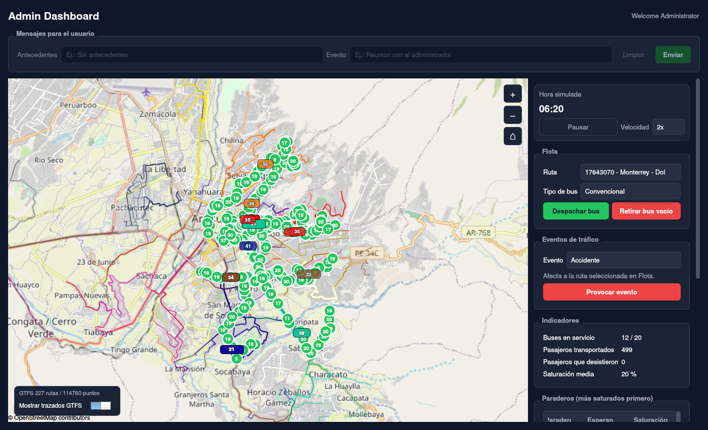
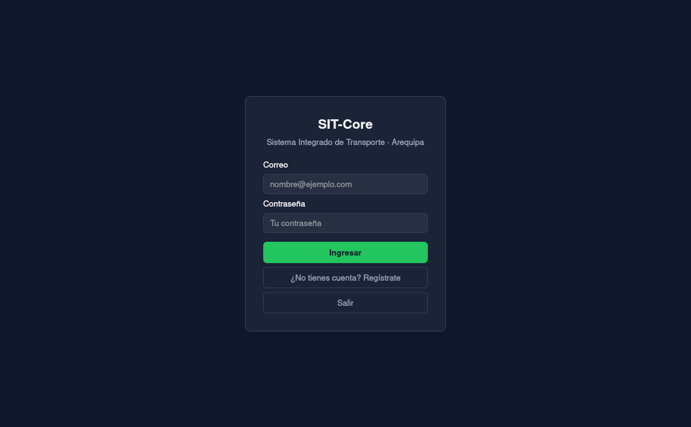
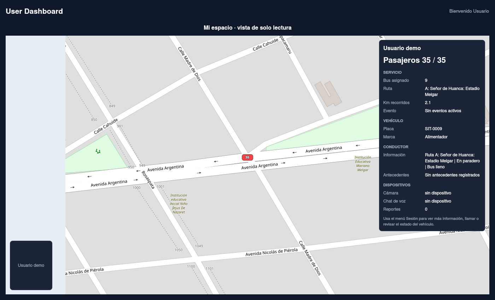
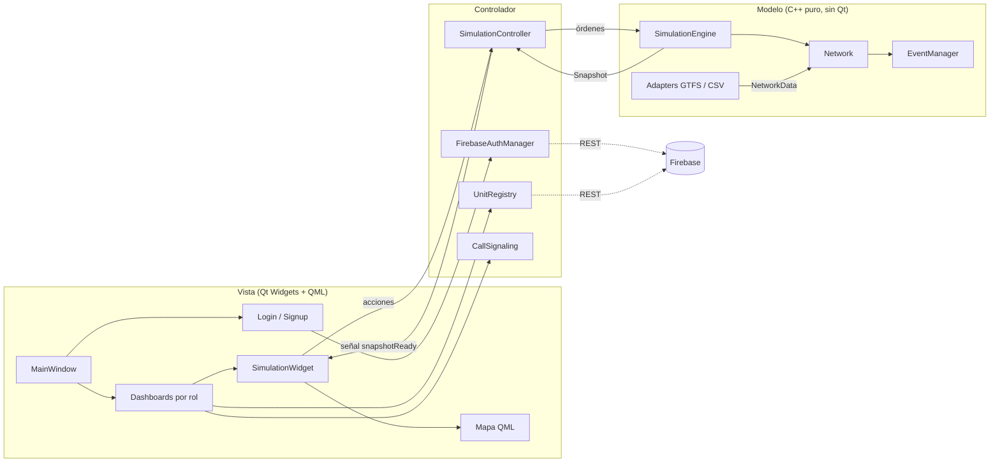
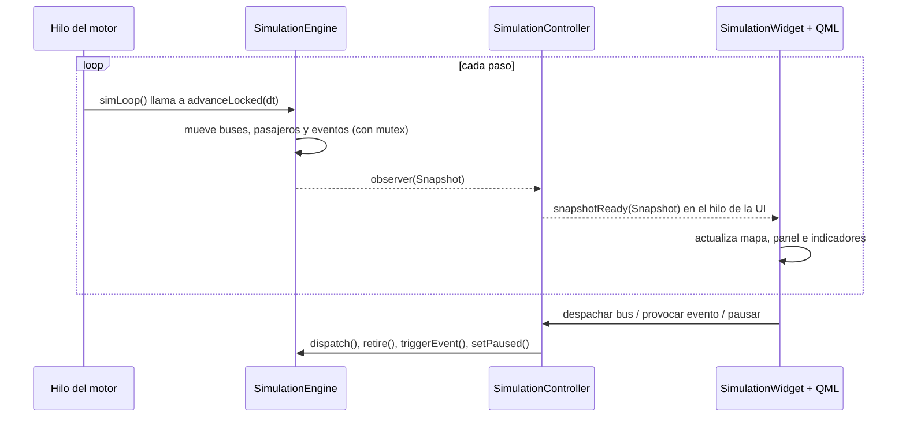
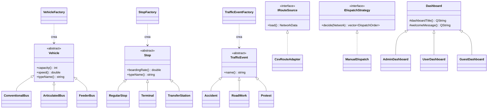

# SIT-Core

Simulador en tiempo real de la red de transporte público de Arequipa. Muestra en un mapa
OpenStreetMap las rutas troncales y alimentadoras, los paraderos y los buses moviéndose por
calles reales. Desde ahí el administrador despacha unidades, provoca eventos de tráfico y ve cómo
reacciona la red; cada conductor ve solo su bus.

Proyecto final del curso Tecnología de Objetos, UNSA, Arequipa 2026. Está escrito en C++17 con
Qt 6 y CMake.



## Qué se puede hacer

El mapa carga 9 rutas simuladas (3 troncales y 6 alimentadoras) con 288 paraderos. Sus trazados
salen de los datos GTFS de Arequipa, que traen 227 rutas reales, así que los buses siguen las
calles y no líneas rectas entre paraderos.

El reloj simulado arranca a las 06:00. Los pasajeros llegan a cada paradero según la hora, con
picos a las 8:00 y a las 18:00. Cuando un paradero se llena, la gente que ya no cabe desiste y se
cuenta en los indicadores. Hay tres tipos de bus (convencional, articulado y alimentador) con
distinta capacidad y velocidad.

El administrador puede:

- despachar un bus en cualquier ruta o retirar uno vacío;
- provocar un accidente, una obra vial que vuelve lenta la ruta o una protesta que cierra un paradero;
- pausar la simulación y cambiar la velocidad entre 1x y 20x;
- hacer clic en un bus para ver su ocupación, su próximo paradero y su estado;
- enviar avisos a los conductores y llamarlos.

El conductor entra con su cuenta y ve un mapa que sigue a su bus, con la ruta, los pasajeros, la
placa y los avisos del administrador. Desde el menú Sesión puede llamar al administrador.

| Inicio de sesión | Vista del conductor |
|---|---|
|  |  |

Las cuentas se guardan en Firebase y cada una tiene un rol: administrador, usuario (conductor) o
invitado. La interfaz está traducida al español, inglés, chino y árabe; en árabe se invierte de
derecha a izquierda.

## Compilar y ejecutar

Necesitas CMake 3.16 o superior, un compilador con C++17 y Qt 6 con los módulos Widgets, Network,
Quick, QuickWidgets, Qml, Positioning y Location. En Ubuntu o Debian:

```bash
sudo apt install cmake g++ libgl1-mesa-dev \
  qt6-base-dev qt6-declarative-dev qt6-positioning-dev qt6-location-dev \
  qt6-location-plugins qml6-module-qtlocation qml6-module-qtpositioning \
  qml6-module-qtquick qml6-module-qtquick-controls
```

Después:

```bash
cmake -S . -B build
cmake --build build -j
./build/src/sit_core                          # abre la aplicación
ctest --test-dir build --output-on-failure    # corre las 15 pruebas
```

En Windows o macOS instala Qt 6 y agrega `-DCMAKE_PREFIX_PATH=<ruta de Qt>`, o abre la carpeta en
Qt Creator. Si Qt LinguistTools (`qt6-tools-dev`) está instalado, las traducciones de `i18n/` se
incluyen solas.

Sin Qt el proyecto también compila: CMake construye solo el modelo y sus 9 pruebas. Así se puede
trabajar en la lógica de la simulación sin instalar nada gráfico.

### Configurar Firebase

El inicio de sesión necesita un archivo `config.ini` en la raíz del proyecto. Está en
`.gitignore`, así que cada integrante tiene su propia copia:

```ini
FIREBASE_API_KEY=...
FIREBASE_PROJECT_ID=...
```

Al compilar, CMake lo copia junto al ejecutable. El mapa base descarga los tiles de OpenStreetMap,
así que hace falta internet; el trazado de las rutas y el movimiento de los buses funcionan sin
conexión.

## Arquitectura

El proyecto sigue el patrón MVC. El modelo es C++ puro y no conoce Qt, por eso se puede probar
sin interfaz. El controlador traduce entre el modelo y la vista, y la vista solo dibuja lo que
recibe.



### Cómo viaja un cuadro de la simulación

El motor corre en su propio hilo para que la interfaz nunca se congele. En cada paso mueve los
buses, sube y baja pasajeros y aplica los eventos activos. Luego arma un `Snapshot`, una copia de
datos simples, y se lo entrega al controlador. La vista nunca toca los objetos del modelo, solo
esas copias, así que no hace falta compartir memoria entre hilos más allá del `std::mutex` del
motor.



### Patrones de diseño

| Patrón | Dónde | Para qué |
|---|---|---|
| Factory Method | `VehicleFactory`, `StopFactory`, `TrafficEventFactory` | Crear buses, paraderos y eventos a partir de un tipo sin que el resto del código conozca las subclases. |
| Builder | `NetworkBuilder` | Armar la `Network` paso a paso desde los datos leídos, validando rutas y paraderos. |
| Adapter | `CsvRouteAdapter` y `GtfsRouteAdapter` detrás de `IRouteSource` | Leer formatos distintos (CSV propio y GTFS) y entregar siempre `NetworkData`. |
| Strategy | `IDispatchStrategy`, `ManualDispatch` | Cambiar la política de despacho sin tocar el motor. |
| Observer | `SimulationEngine::setObserver` | El motor avisa cada `Snapshot` sin saber quién lo recibe. |
| Singleton | `FirebaseAuthManager::instance()`, `UnitRegistry::instance()` | Una sola sesión y un solo registro de unidades en toda la aplicación. |

### Jerarquías de clases



Cada rol tiene su propia página, que hereda de `Dashboard` y redefine su título y su contenido.
Para agregar un rol nuevo basta con otra subclase registrada en `MainWindow`.

### Qué pide la rúbrica y dónde está

| Criterio | En el código |
|---|---|
| MVC | `src/model`, `src/controller` y `src/view`; el modelo no incluye Qt. |
| Patrones de diseño | Seis patrones, ver la tabla de arriba. |
| Herencia y polimorfismo | `Vehicle`, `Stop`, `TrafficEvent` y `Dashboard` con métodos virtuales. |
| Punteros inteligentes | `unique_ptr` para buses, eventos y la red; `shared_ptr` para rutas y paraderos compartidos; `weak_ptr` para que el bus observe su ruta sin ser su dueño. |
| Genéricos | Plantilla `Repository<T>` en `src/common/Repository.h`. |
| Manejo de errores | Jerarquía `SitException` (`InvalidRouteException`, `CapacityExceededException`, `DataLoadException`...). La vista muestra el error en lugar de cerrarse. |
| Sobrecarga de operadores | `Position` (`+ - == !=`, `<<`), `Stop::operator<`, `operator<<` de `Vehicle`. |
| Lambdas y STL | `sort`, `find_if`, `any_of` y `count_if` en `Network`, `EventManager` y `Repository`. |
| Concurrencia | `std::thread`, `std::mutex` y `std::atomic` en `SimulationEngine`. |
| Pruebas unitarias | 15 ejecutables en `tests/` con CTest; 9 del modelo y 6 de la interfaz. |
| Git, CMake y CI | CMake modular con `file(GLOB)` y GitHub Actions que compila y prueba cada push. |

## Estructura del repositorio

```
src/
  common/      excepciones, Position, GeoCoordinate, Repository<T>
  model/       simulación: red, rutas, paraderos, buses, eventos, motor, adapters
  controller/  SimulationController, Firebase, registro de unidades, llamadas
  view/        ventana principal, login, dashboards, panel de simulación, theme.qss
  qml/         mapa, marcadores de buses y paraderos, vista del conductor
tests/         una prueba por tema: test_<tema>.cpp
data/          red de ejemplo (network.csv) y datos GTFS de Arequipa
i18n/          traducciones es, en, zh y ar
docs/          capturas de pantalla de la interfaz
```

Para agregar una prueba basta con crear `tests/test_<tema>.cpp`; CMake la encuentra sola. Las que
empiezan con `test_gui_` usan Qt y corren sin pantalla (`QT_QPA_PLATFORM=offscreen`).

### Formato de la red

`data/network.csv` describe paraderos, rutas y trazados. Las filas `STOP` llevan 7 columnas con
coordenadas x/y, o 9 si incluyen `lat,lon`; cuando faltan, la red calcula la latitud y longitud
desde x/y. Las filas `PATH,ruta,x,y[,lat,lon]` dan el recorrido ordenado de cada ruta. Si una ruta
no tiene `PATH` pero su fila `ROUTE` trae un `shapeId` de GTFS, se usa `data/shapes.txt`; si no
tiene ninguno de los dos, el bus va en línea recta entre paraderos.

## Pendiente para la Demo 2

- Despacho automático cuando un paradero se satura, como segunda estrategia de despacho.
- Eventos de tráfico aleatorios generados en un segundo hilo.
- Adapter para JSON y una fábrica de fuentes de datos.
- Diagramas UML completos, informe final y análisis de impacto social.

## Equipo

| Integrante | Código |
|---|---|
| Retamozo Calatayud Angel Julio | 202423334 |
| Castillo Lazo Rodrigo Zara | 20210552 |
| Estefanero Palma Rodrigo | 20243390 |
| Mamani Quispe Renzo Geomar | 20243396 |
| Camani Chambi Ronald Rodrigo | 20181697 |
| Sarmiento Tico Limberg | 20243386 |

Universidad Nacional de San Agustín de Arequipa, 2026.
