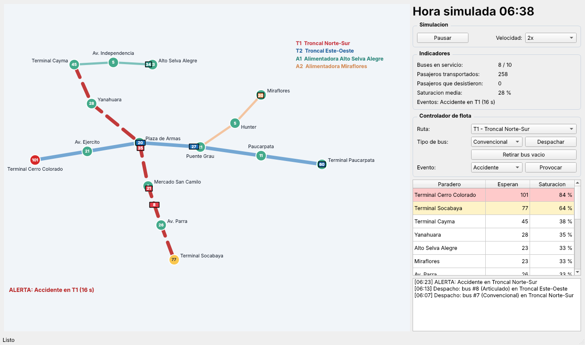

# SIT-Core — Demo 1

**Simulador y gestor en tiempo real de una red de transporte publico urbano** (rutas troncales y
alimentadoras de Arequipa). Proyecto final de Tecnologia de Objetos — UNSA, Arequipa 2026.



## Que hace la Demo 1

- Mapa en vivo con 2 rutas **troncales** (T1, T2) y 2 **alimentadoras** (A1, A2), 15 paraderos.
- 3 tipos de bus (convencional, articulado, alimentador) con distinta capacidad y velocidad.
- Pasajeros que llegan segun la hora (horas punta 8:00 y 18:00); reloj simulado desde las 06:00.
  Un paradero desbordado rechaza gente ("desistieron").
- **Eventos de trafico** provocados a mano: accidente, obra vial (ruta lenta) y protesta (cierra un paradero).
- **Controlador de flota**: despachar y retirar buses desde el panel; pausa y velocidad 1x–20x.
- Indicadores en vivo y registro de eventos.

Llega en la **Demo 2**: despacho automatico por saturacion (2da estrategia), eventos aleatorios en un
segundo hilo, adapter JSON + factory de fuentes, documentacion final (UML, informe, impacto social).

## Compilar y ejecutar

Requisitos: CMake >= 3.16, compilador C++17 y Qt 6 (Widgets).

```bash
sudo apt install cmake g++ qt6-base-dev       # Ubuntu / Debian
cmake -S . -B build
cmake --build build -j
./build/src/sit_core                          # abre la aplicacion
ctest --test-dir build --output-on-failure    # 7 pruebas
```

Windows / macOS: instalar Qt 6 y pasar `-DCMAKE_PREFIX_PATH=<ruta de Qt>` (o abrir en Qt Creator).
Sin Qt, CMake compila solo el modelo y las pruebas que no usan interfaz.

## Arquitectura (MVC)

```
 Vista (Qt)              Controlador                 Modelo (C++ puro, sin Qt)
 MainWindow, MapView <-- SimulationController  <---- SimulationEngine (hilo propio)
        |  acciones          |  slots/senales              |  Network, Route, Stop, Vehicle,
        +------------------->+---------------------------->|  EventManager, IDispatchStrategy
```

El modelo corre en otro hilo y habla con la vista solo mediante `Snapshot` (copias de datos simples).

## Cumplimiento de la consigna (estado Demo 1)

| Requisito | Donde |
|---|---|
| MVC | `model/` · `controller/` · `view/` |
| Patron creacional | Factory Method (`VehicleFactory`, `StopFactory`, `TrafficEventFactory`) y Builder (`NetworkBuilder`) |
| Patron estructural | Adapter (`CsvRouteAdapter` → `IRouteSource`) |
| Otros patrones | Strategy (`IDispatchStrategy`), Observer (`SimulationEngine` → controlador) |
| POO avanzada | herencia y polimorfismo (`Vehicle`, `Stop`, `TrafficEvent`), `unique_ptr`/`shared_ptr`/`weak_ptr`, plantilla `Repository<T>`, jerarquia de excepciones |
| Lambdas | `sort`, `find_if`, `any_of`, `count_if` en `Network`, `EventManager`, `Repository` |
| Sobrecarga de operadores | `Position` (`+ - == !=`, `<<`), `Stop::operator<`, `operator<<` de `Vehicle` |
| Multihilo | `std::thread`, `std::mutex`, `std::atomic` en `SimulationEngine` |
| Git y CMake | ramas por integrante + PR con revision; CMake con `file(GLOB)` para no pisar el CMake de otros |
| Pruebas unitarias | `tests/` (CTest, 7 ejecutables) |
| CI | `.github/workflows/ci.yml` |

## Quien subio que

Ver [`docs/DEMO1_SUBIDA.md`](docs/DEMO1_SUBIDA.md).

## Integrantes

| Integrante | Codigo |
|---|---|
| Retamozo Calatayud Angel Julio | 202423334 |
| Castillo Lazo Rodrigo Zara | 20210552 |
| Estefanero Palma Rodrigo | 20243390 |
| Mamani Quispe Renzo Geomar | 20243396 |
| Camani Chambi Ronald Rodrigo | 20181697 |
| Sarmiento Tico Limberg | 20243386 |

Arequipa, 2026.
